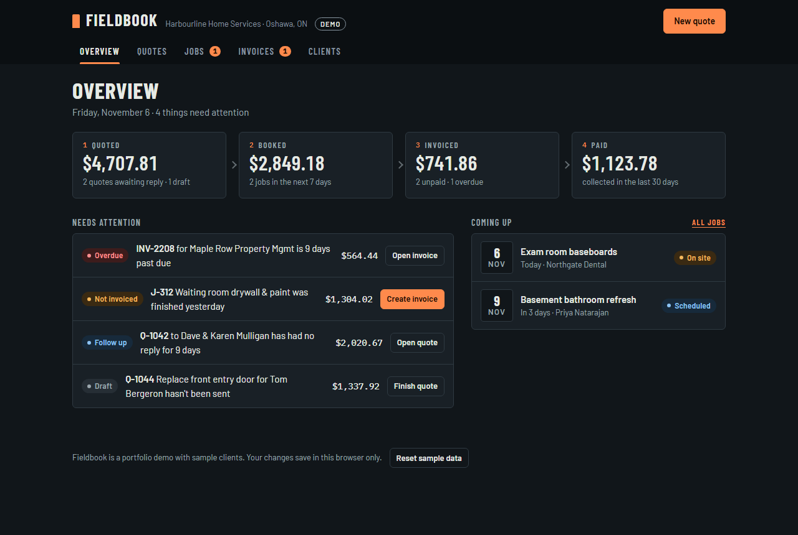
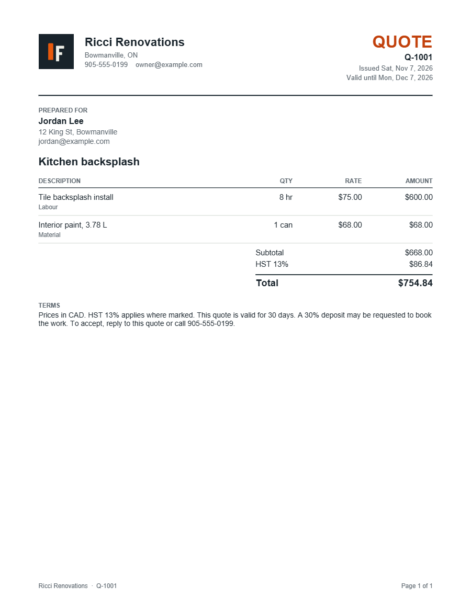

# Fieldbook

**Free quotes, jobs and invoices for trade and service businesses.** Price a job, book it, invoice it and get paid, from your phone or computer. There's no account and no subscription, and your data never leaves your device.

**[Open Fieldbook →](https://lilmoike.github.io/fieldbook/)**  ·  Set up your business in a minute, or explore a sample business first.

## What you can do

| | |
|---|---|
| **Quotes** | Line items for labour, materials and flat fees · one-click price book · discounts · the right sales tax for your province · accepted quotes become jobs |
| **Jobs** | Work orders with dates, checklists and site notes · extra work found on site carries over to the invoice |
| **Invoices** | Created from a finished job in one click · payment terms · partial payments · deposits credited automatically · late fees · void instead of delete, so numbering has no gaps |
| **Send it** | **Download a PDF**, **share it** straight to Messages, WhatsApp or email from your phone, or open a pre-written email to your client |
| **Get paid** | Friendly and overdue reminder messages · a "who owes you" aging report · an activity log on every invoice |
| **Your brand** | Your logo, business details and GST/HST number on every PDF · carry on from your existing quote and invoice numbers |
| **Install it** | Add it to your phone's home screen and it works like an app, even offline |

## Your data

Everything is saved in your browser on your device. Nothing is uploaded, so nobody else can see your clients or invoices. That also means:

- **Download a backup regularly** (Settings → Your data). Fieldbook reminds you every two weeks.
- **To move to a new phone or computer**, restore that backup file there.
- Clearing your browser's site data erases Fieldbook's data on that device.

## Sales tax

Fieldbook charges HST, GST + PST, or GST + QST based on your province or territory, and you can switch tax off for any line. Each quote and invoice keeps the rate it was created with. Tax rules for some services vary, so check with your accountant if you're unsure.

## How it's built

- **One HTML file, no framework, no build step, no server.** Plain HTML, CSS and JavaScript in [`index.html`](index.html), with [jsPDF](https://github.com/parallax/jsPDF) for PDFs.
- **Money is handled in integer cents**, so totals and tax never drift from rounding.
- **Status is derived, not stored.** An invoice's status (draft, sent, part paid, overdue, paid, void) is computed from its payments, due date and flags, so it can't fall out of sync.
- **Installable and offline** through a web app manifest and a service worker ([`sw.js`](sw.js)).
- **Tested** with Playwright in headless Edge: setup, the full quote-to-paid flow, tax and deposit math, PDF contents, backup and restore, and phone layouts.

## Roadmap

- Sync between devices (optional, for crews)
- Recurring invoices for maintenance contracts
- Client statements listing every open invoice
- Online card payments

## License

[MIT](LICENSE) © 2026 Michael Ricci
